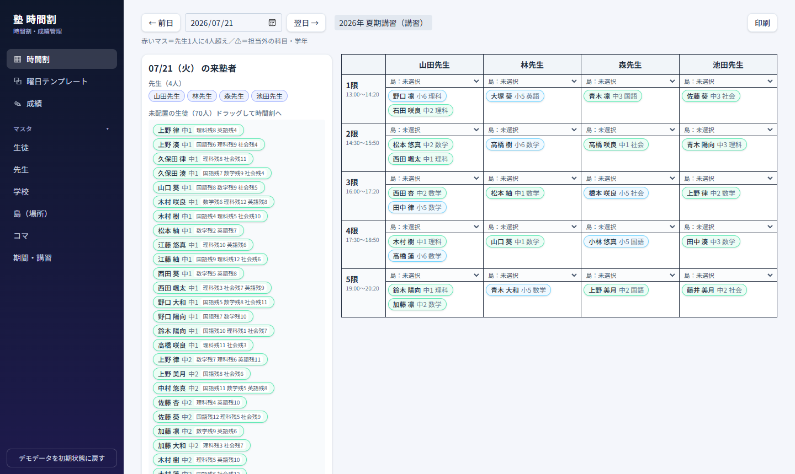
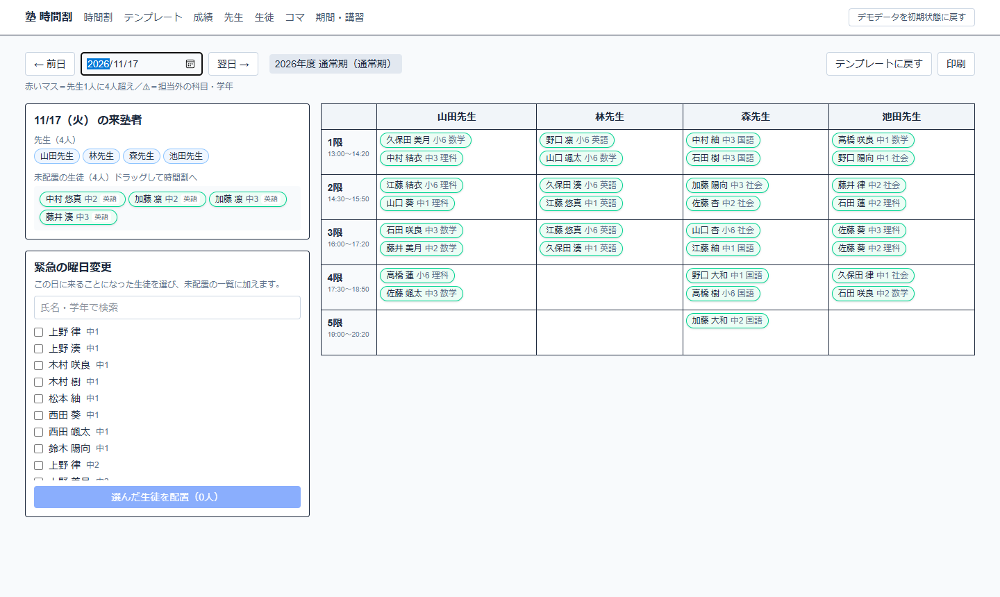
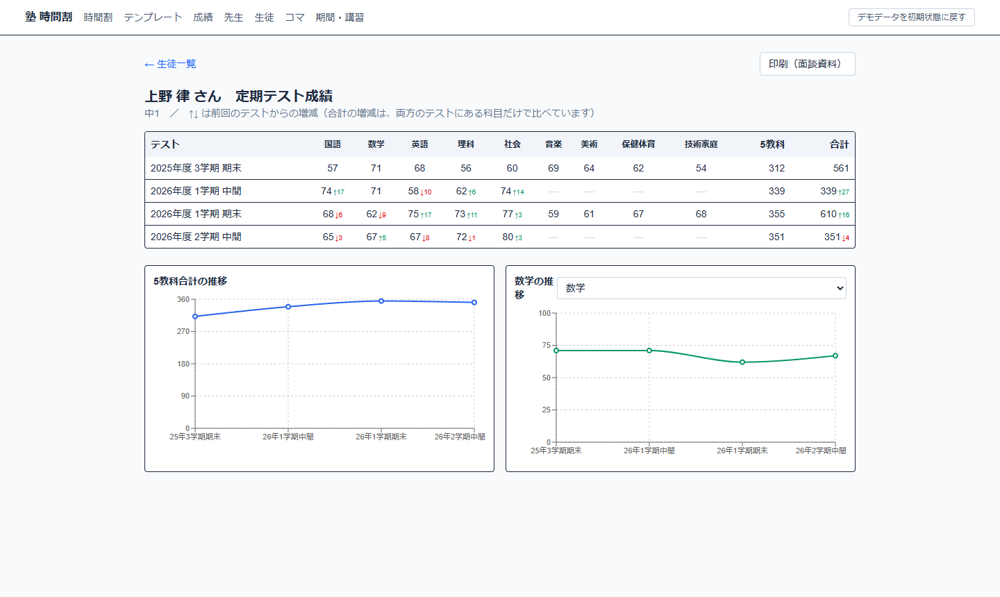
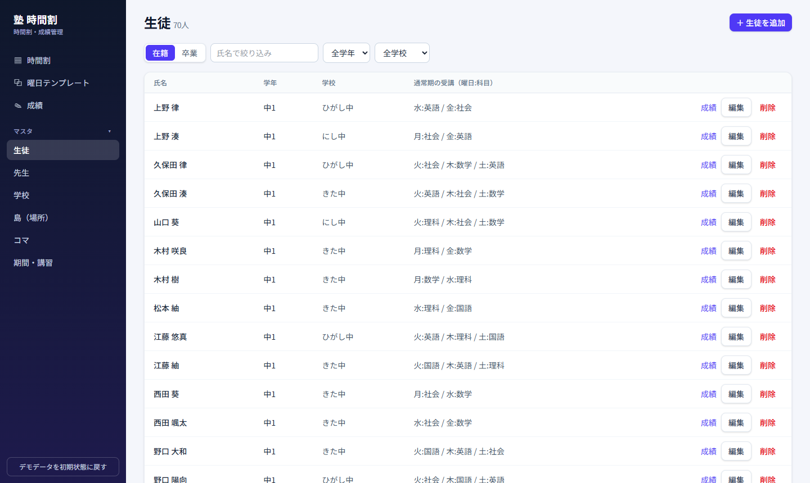

# 個人塾 時間割アプリ

個人塾の「講習期間の時間割づくり」を、ドラッグ＆ドロップで行えるWebアプリです。

**デモ：** https://juku-timetable-navy.vercel.app （「ゲストとして試す」で入れます。時間割で 7/21 を開くと講習の配置例が見られます）

## なぜ作ったか

塾講師をしていたとき、長期休暇の講習では生徒の希望（科目ごとのコマ数・来られる日）を紙やExcelで集め、
先生の出勤日と突き合わせながら手作業で時間割を組んでいました。
講師5人・生徒約70人・1コマ25人前後という規模でも、
「先生1人に4人まで」「担当できる科目・学年」「同じ生徒を同じコマに入れない」「申込コマ数の残り」を
頭の中で同時に確認する必要があり、ミスと時間の原因になっていました。
このアプリは、その確認を画面が肩代わりすることを目的にしています。

## 主な機能

- **時間割（左：来塾者／右：コマ×先生の表）**
  - その日に来る先生・生徒を、曜日（通常期）や来塾可否（講習）から自動で表示
  - 生徒をドラッグして配置、表内での移動、一覧に戻して取り消し
  - 複数科目を受ける生徒は、置いたときに科目を選択
  - 先生1人に4人を超えたマスは赤く表示（実際の運用に合わせ、配置自体は可能）
  - 担当外の科目・学年は ⚠ で警告、同じコマへの二重配置は拒否
  - 講習では科目ごとの残りコマ数を表示
  - 緊急の曜日変更：その日だけ来る生徒をチェックして追加
- **曜日テンプレート**：通常期の「いつもの月〜金の時間割」を作っておくと、日付を開いたときにその曜日の時間割が最初から並ぶ。その日の変更（欠席・振替）はその日だけで、翌週は元どおり。「テンプレートに戻す」「印刷（A4横）」付き
- **定期テストの成績管理**：テストごとに生徒×9教科の表でまとめて入力（0〜100の整数のみ、空欄は未受験）。生徒ごとの面談資料ページに、前回からの増減（↑↓）、5教科合計と科目別の推移グラフ、印刷（A4縦）

- **島（場所）**：時間割・テンプレートの各マス（コマ×先生）で使う島を選べる。同じコマで島が重なると ⚠
- **学年の繰り上げ**：4月以降に生徒画面のボタンで全員の学年を1つ上げる（中3→高1、高3→卒業。1年度に1回だけ、二重実行はDBで防止）
- **マスタ管理**（左メニューの「マスタ」）：生徒（学年・学校・通常の曜日と科目、在籍／卒業）、先生、学校、島、コマ、期間・講習

- **デモ**：ゲストとしてログインして試せます。データは毎日3時（日本時間）に初期状態へ戻り、画面上部のボタンでも戻せます。

※ 登録されているデータはすべて架空のものです。

## 技術構成

| 分類 | 使用技術 |
| --- | --- |
| フロントエンド | Next.js 15（App Router）, React 19, TypeScript, Tailwind CSS, dnd-kit, Recharts |
| バックエンド / DB | Supabase（PostgreSQL, Row Level Security, 匿名ログイン） |
| ホスティング | Vercel（Cron でデモデータを毎日リセット） |
| テスト | Vitest（来塾者の判定・残りコマ数・警告・テンプレート反映・成績の比較などの業務ロジックをテスト駆動で実装） |

業務ルールは `src/domain/` に画面やDBから独立した関数としてまとめ、テストで守っています。

## 開発の進め方

AI駆動開発（Claude Code）で作成しました。
要件の整理 → 設計書（`docs/superpowers/specs/`）→ 実装計画（`docs/superpowers/plans/`）→ テスト駆動での実装、
という流れで、仕様の判断とレビューは自分で行い、実装をAIと分担しています。

## ローカルでの起動

手順は [docs/02_ローカル起動手順書](docs/02_ローカル起動手順書.md)、初回の準備は [docs/01_ローカル環境構築書](docs/01_ローカル環境構築書.md) を参照してください。設計書・CRUD表などのドキュメント一覧は [docs/README.md](docs/README.md) にあります。

## 今後の予定

- 返却された答案用紙の画像から点数を読み取る機能（AI-OCR）
