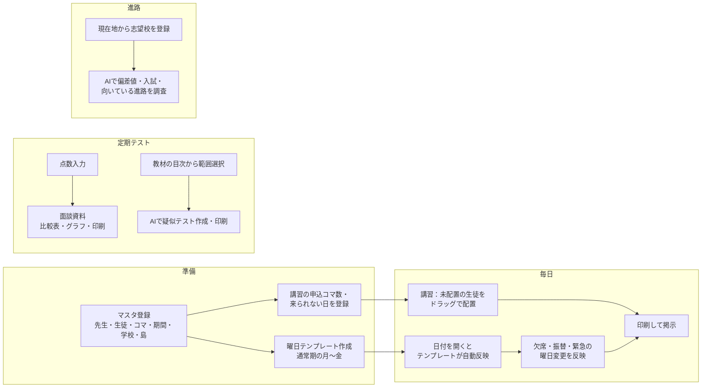
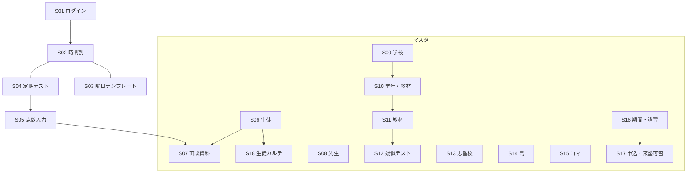
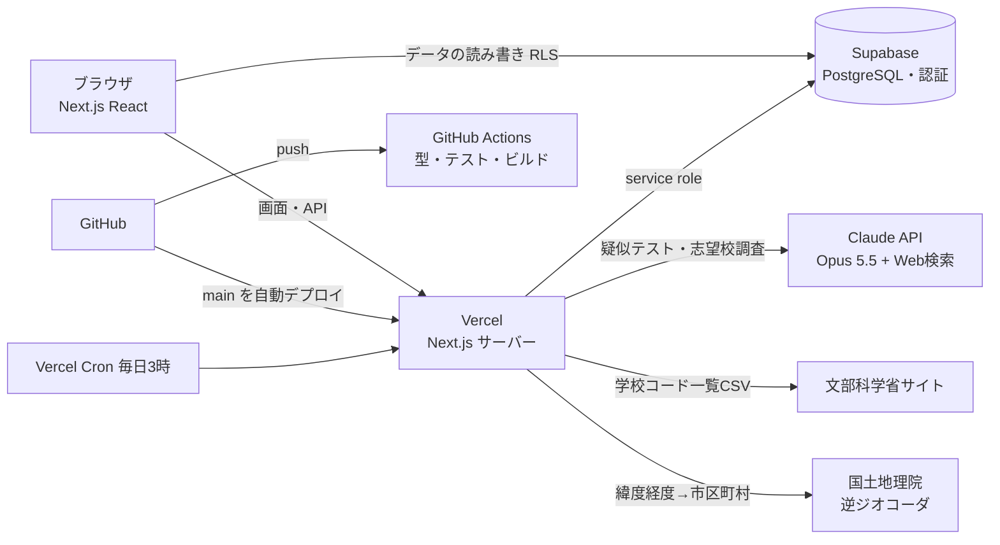

# 03 基本設計書

## 1. システムの目的

個人塾の講師・塾長が、次の業務を1つの画面で行えるようにします。
- 時間割づくり（特に長期休暇の講習）
- 通常期の毎日の時間割の管理
- 定期テストの成績管理と、保護者面談の資料づくり
- 志望校の情報整理

### 背景（現状の課題）
- 講習では、生徒の希望（科目ごとのコマ数・来られる日）を紙や Excel で集め、先生の出勤日と突き合わせて手作業で時間割を組んでいた
- 「先生1人に生徒4人まで」「担当できる科目・学年」「同じ生徒を同じコマに入れない」「申込コマ数の残り」を頭の中で同時に確認する必要があり、ミスと時間の原因になっていた
- 通常期は毎週ほぼ同じ時間割を Excel で直して印刷していた
- 面談資料（前回との比較表・グラフ）を毎回手で作っていた

### 想定規模
講師5人程度・生徒約70人・1コマ約25人・コマ5つ／日

## 2. 利用者と前提

| 利用者 | 説明 |
|---|---|
| 塾長・講師 | 本アプリの利用者。1920×1080 の PC 画面での利用を主に想定 |
| ゲスト | 公開デモの閲覧者。匿名ログインで全機能を試せる（データは架空、毎日初期化） |

- 1つの塾で使う前提（複数塾の切り替えはなし）
- 公開版は架空データだけのデモ。実データを扱う段階では、職員ログインとゲストの分離が必要（[10章](#10-今後の課題)）

## 3. 業務フロー

## 4. 機能一覧

| No | 機能 | 概要 |
|---|---|---|
| F01 | ゲストログイン | 匿名ログインでデモに入る |
| F02 | 時間割（講習） | 来塾者の一覧から、コマ×先生の表へドラッグ＆ドロップで配置。科目選択・残りコマ数表示 |
| F03 | 時間割の警告 | 先生1人に4人超で赤、担当外の科目・学年に ⚠、同じコマへの二重配置を拒否 |
| F04 | 緊急の曜日変更 | その日だけ来る生徒をチェックして追加 |
| F05 | 曜日テンプレート | 通常期の月〜金の「いつもの時間割」と島を登録 |
| F06 | テンプレートの自動反映 | 通常期の日付を開くと、その曜日のテンプレートをその日の配置としてコピー（1回だけ）。「テンプレートに戻す」 |
| F07 | 島（場所） | 時間割・テンプレートのマスごとに教室内の島を選ぶ。重複を ⚠ |
| F08 | 時間割の印刷 | A4横で表だけを印刷 |
| F09 | 定期テスト・点数入力 | テストごとに生徒×9教科をまとめて入力。学年・学校で絞り込み、平均点 |
| F10 | 面談資料 | 生徒ごとの点数表、前回比 ↑↓、5教科合計と科目別の推移グラフ、A4縦で印刷 |
| F11 | マスタ管理 | 生徒・先生・学校・島・コマ・期間・講習（申込コマ数・来塾可否） |
| F12 | 学年の繰り上げ | 4月以降にボタンで全員の学年を1つ上げる（年度1回） |
| F13 | 学校の教材 | 学校×学年×科目ごとに教科書・ワークを登録 |
| F14 | 教材の目次 | 教材ごとに単元を登録（まとめて貼り付け可） |
| F15 | AI疑似テスト | 目次のチェックした範囲・種類（文法・単語など）・問題数・難易度で、Claude が練習問題を作成。解答表示・印刷 |
| F16 | 志望校マスタ | 現在地の県＋隣県の私立中学・全高校を文科省データから登録・更新 |
| F17 | 志望校のAI調査 | Web検索で偏差値・学科・入試日程・科目・倍率・向いている進路を調査（出典付き） |
| F19 | 授業記録（生徒カルテ） | 時間割の配置済みの生徒をクリックして、教材・範囲・理解度・宿題・申し送りを記録。同じ科目の前回の記録を表示。生徒ごとのカルテ画面 |
| F18 | デモの初期化 | ボタン、または毎日3時（日本時間）に架空データへ戻す |

## 5. 画面一覧

| ID | 画面 | URL | 主な機能 |
|---|---|---|---|
| S01 | ログイン | `/login` | F01 |
| S02 | 時間割 | `/timetable` | F02〜F08 |
| S03 | 曜日テンプレート | `/templates` | F05, F07 |
| S04 | 定期テスト一覧 | `/tests` | F09 |
| S05 | 点数入力 | `/tests/[id]` | F09 |
| S06 | 生徒マスタ | `/students` | F11, F12 |
| S07 | 面談資料（生徒の成績） | `/students/[id]/grades` | F10 |
| S08 | 先生マスタ | `/teachers` | F11 |
| S09 | 学校マスタ | `/schools` | F11 |
| S10 | 学校の学年・科目・教材 | `/schools/[id]` | F13 |
| S11 | 教材（目次・疑似テスト作成） | `/materials/[id]` | F14, F15 |
| S12 | 疑似テスト | `/materials/[id]/tests/[tid]` | F15 |
| S13 | 志望校マスタ | `/target-schools` | F16, F17 |
| S14 | 島マスタ | `/islands` | F07 |
| S15 | コママスタ | `/periods` | F11 |
| S16 | 期間・講習 | `/terms` | F11 |
| S17 | 講習の申込・来塾可否 | `/terms/[id]` | F11 |
| S18 | 生徒カルテ（授業記録） | `/students/[id]/records` | F19 |

画面遷移（左メニューから各画面へ移動。マスタは「マスタ」グループにまとめる）

## 6. システム構成

| 区分 | 採用技術 |
|---|---|
| 画面 | Next.js 15（App Router）、React 19、TypeScript、Tailwind CSS v4、dnd-kit（ドラッグ）、Recharts（グラフ） |
| サーバー | Next.js の Route Handler（Vercel の関数） |
| DB・認証 | Supabase（PostgreSQL、Row Level Security、匿名ログイン） |
| AI | Anthropic Claude API（`claude-opus-5-5`、構造化出力、Web検索ツール） |
| 外部データ | 文部科学省「学校コード一覧」CSV、国土地理院 逆ジオコーダAPI |
| テスト | Vitest（業務ルールの単体テスト） |
| CI/CD | GitHub Actions（型チェック・テスト・ビルド）、Vercel（main を本番に自動デプロイ） |

### ソースの構成
| 場所 | 役割 |
|---|---|
| `src/domain/` | 業務ルール（画面やDBに依存しない純粋な関数）とテスト |
| `src/lib/repo.ts` | DBの読み書き（行⇔ドメイン型の変換） |
| `src/lib/supabase/` | Supabase の接続（ブラウザ用・サーバー用） |
| `src/app/(app)/` | ログイン後の各画面 |
| `src/app/api/` | サーバーAPI |
| `src/components/` | 共通部品（ボタン・表・モーダル・サイドバー・時間割の部品） |
| `supabase/migrations/` | DB変更のSQL（番号順に適用） |

## 7. 外部インターフェース

| 相手 | 方向 | 内容 | タイミング |
|---|---|---|---|
| Claude API | 送信／受信 | 単元名などから疑似テストを作成。学校名から入試情報をWeb検索して要約 | ボタン押下時（1日の上限あり） |
| 文部科学省 | 受信 | 学校コード一覧のページから最新CSVのURLを探し、CSVを取得 | 志望校の登録・更新ボタン押下時 |
| 国土地理院 | 送信／受信 | 緯度経度 → 市区町村コード（先頭2桁が都道府県） | 「現在地を取得」押下時 |
| Vercel Cron | 受信 | `GET /api/reset`（合言葉付き）でデモを初期化 | 毎日 18:00 UTC（日本時間 3:00） |

## 8. 非機能要件

| 項目 | 内容 |
|---|---|
| 画面サイズ | 1920×1080 を主対象。スマホ幅でもメニューを開閉して操作可能 |
| 応答時間 | 通常の画面操作は1秒程度。AI疑似テストは15〜30秒、志望校のAI調査は1分前後、志望校の登録・更新は数秒〜1分 |
| 同時操作 | 二重配置・テンプレートの二重反映・学年の二重繰り上げ・AI回数の超過を、DBの一意制約とトランザクションで防ぐ |
| 印刷 | 時間割は A4横、面談資料・疑似テストは A4縦。印刷時はメニュー等を非表示 |
| 費用 | AIは1日あたり 疑似テスト20回・志望校調査10校（デモ全体）。それ以外は無料枠で運用 |
| 可用性 | Vercel・Supabase のサービス水準に従う。障害時もデモのため業務影響なし |

## 9. セキュリティ

| 項目 | 対策 |
|---|---|
| 認証 | Supabase の匿名ログイン。未ログインはログイン画面へ転送（middleware） |
| データへのアクセス | 全テーブルで RLS を有効化し、ログイン済み（authenticated）のみ読み書き可 |
| 秘密情報 | service role キー・CRON_SECRET・Claude API キーはサーバーの環境変数だけに置き、ブラウザへは出さない（`NEXT_PUBLIC_` を付けない） |
| 管理系の処理 | デモ初期化（`reset_demo`）と AI回数の消費は `security definer` 関数とし、実行権限を service role のみに限定 |
| AI費用の暴走防止 | 1日の回数上限をDB関数で原子的に判定。失敗時は回数を戻す |
| 外部入力 | API の入力値はドメイン関数でチェック（範囲・種類・件数・点数など）。位置情報は日本の範囲だけ受け付ける |
| 個人情報 | 架空データのみ。実在の生徒名・答案は扱わない |

## 10. 今後の課題

- 職員アカウントとゲストの分離（実データを扱う前に必須）
- 講習で申込のない生徒を緊急追加したときの表示
- 横に広い時間割の印刷の改善
- 答案用紙の画像から点数を読み取る機能（AI-OCR。費用のため保留）
