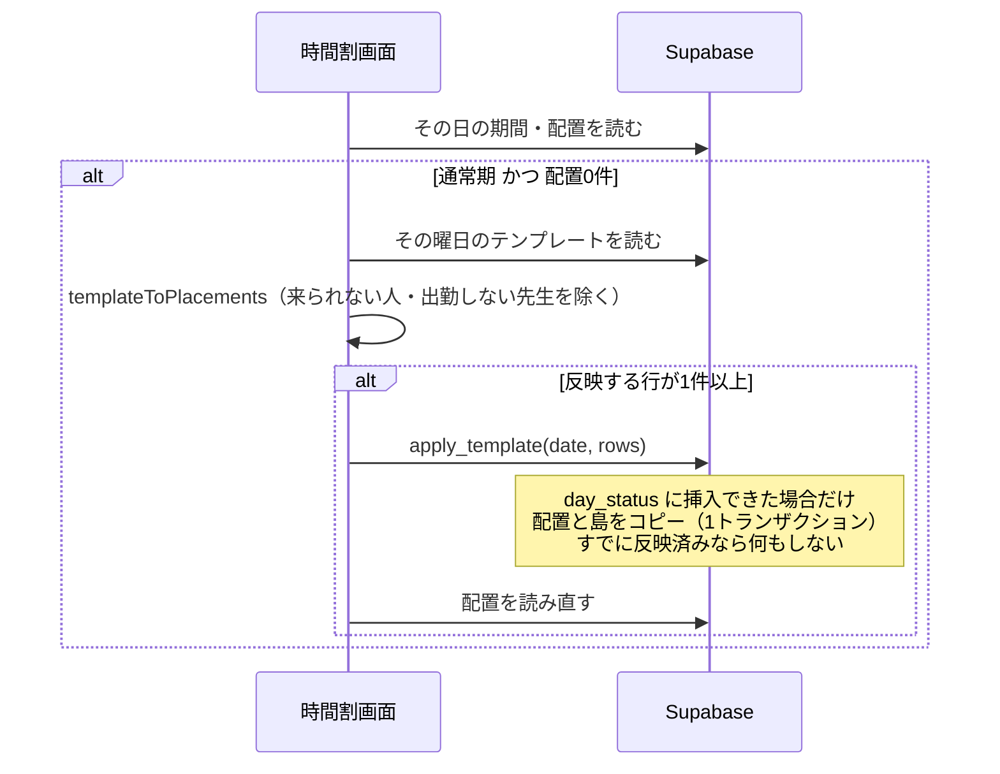
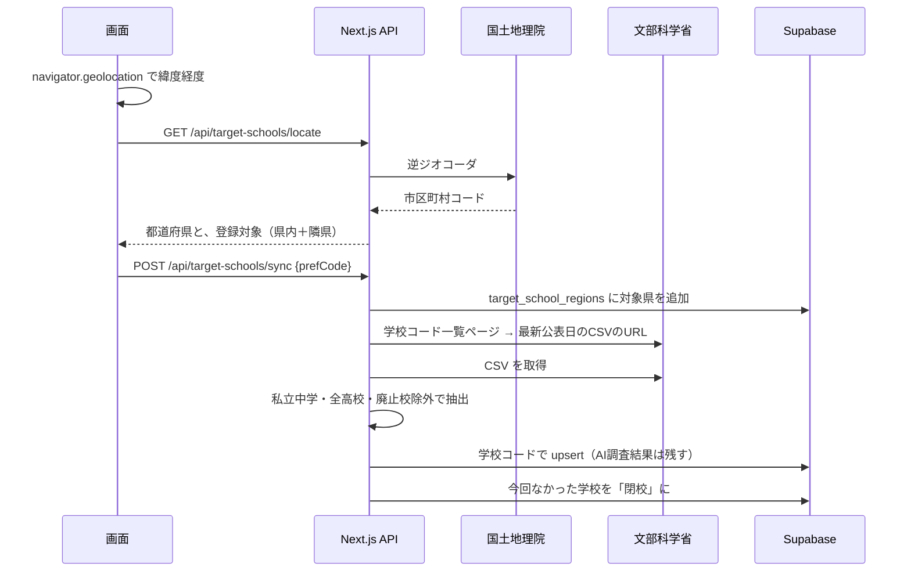

# 04 詳細設計書

[03 基本設計書](03_基本設計書.md) の機能を、画面の動き・業務ルール・処理の流れのレベルで説明します。テーブルの詳細は [05 テーブル定義書](05_テーブル定義書.md)、APIの入出力は [07 API仕様書](07_API仕様書.md) を参照してください。

## 1. 共通設計

### 1.1 レイヤ構成
| 層 | 場所 | 方針 |
|---|---|---|
| 画面 | `src/app/(app)/**/page.tsx` | すべてクライアントコンポーネント。データ読み込みは共通フック `useLoad` |
| 業務ルール | `src/domain/*.ts` | 画面・DBに依存しない純粋関数。Vitestでテスト |
| データアクセス | `src/lib/repo.ts` | Supabase の行（snake_case）⇔ ドメイン型（camelCase）の変換と CRUD |
| サーバーAPI | `src/app/api/**/route.ts` | 秘密キーや外部API・AIが必要な処理だけ |
| DB関数 | `supabase/migrations/*.sql` | 複数テーブルを1トランザクションで更新する処理、回数制限 |

### 1.2 共通部品（`src/components/`）
| 部品 | 役割 |
|---|---|
| `useLoad(fn, deps)` | 読み込みと再読み込み。**新しい読み込みが始まったら古い結果は捨てる**（日付を素早く切り替えたときの表示ずれ防止） |
| `Button` / `Field` / `Modal` / `Table` / `CheckGroup` / `PageTitle` / `ErrorText` | 見た目をそろえた基本部品 |
| `Sidebar` | 左メニュー。現在の画面を強調、マスタは開閉、スマホはハンバーガーで開閉 |
| `ResetButton` | デモデータの初期化（確認ダイアログ付き） |
| `timetable/Cell` | ドロップ先。人数超過で赤、ドラッグ中は青枠 |
| `timetable/StudentChip` | ドラッグできる生徒。学年で色分け（小：水色、中：緑、高：紫）、担当外は ⚠ |
| `timetable/SubjectPicker` | 複数科目の生徒を置いたときの科目選択 |
| `timetable/IslandSelect` | マスの島の選択。重複時に ⚠、印刷時は島名だけ表示 |

### 1.3 認証とアクセス制御
- `src/middleware.ts`：未ログインで `/login` と `/api/reset` 以外にアクセスしたら `/login` へ転送。ログイン済みで `/` か `/login` に来たら `/timetable` へ
- `(app)/layout.tsx`：サーバー側でもログインを確認し、なければ `/login` へ
- DB：全テーブル RLS「authenticated all」（ログイン済みなら読み書き可）

### 1.4 日付
- 日付は `YYYY-MM-DD` の文字列で扱い、曜日は `weekdayOf()`（タイムゾーンに依存しない計算、0=日）
- 「今日」・AI回数の日付は日本時間（UTC+9）

## 2. 時間割（S02）

### 2.1 その日の期間
`termForDate(terms, date)`：その日を含む期間のうち **講習を優先**、なければ通常期、どちらもなければ「期間外」。

### 2.2 来塾者
| 対象 | ルール（`teachersForDate` / `studentsForDate`） |
|---|---|
| 先生 | 出勤曜日に含まれる先生。ただし期間内の「来られない」「来られる」登録があればそれを優先 |
| 生徒（通常期） | その曜日に受講科目がある生徒。来塾可否の登録があれば優先 |
| 生徒（講習） | その講習に申込がある生徒。来塾可否の登録があれば優先 |
| 緊急の曜日変更 | その日に追加された生徒は、上の条件に関係なく来塾者に含める |
| 卒業生 | 来塾者・一覧には出さない（配置済みのチップは表示する） |

### 2.3 未配置の一覧に出す科目（`subjectsLeftToday`）
- **講習**：申込の残りコマ数が1以上の科目（同じ日に複数コマ可）。残り = 申込コマ数 − 講習期間内の配置数（0未満にしない）
- **通常期**：その曜日の受講科目。その曜日の科目がなければ（緊急追加など）全受講科目。そのうち今日まだ配置していない科目

### 2.4 ドラッグ＆ドロップ
| 操作 | 処理 |
|---|---|
| 一覧 → マス | 二重配置チェック → 科目が1つならそのまま配置、複数なら科目選択 → `placements` に追加 |
| マス → 別のマス | 二重配置チェック → `placements` の コマ・先生 を更新（残りコマ数は変わらない） |
| マス → 一覧 | `placements` から削除 |
| 二重配置 | 画面で事前チェック（同じ日・同じコマに同じ生徒）。DBの一意制約（date, period_id, student_id）でも防ぎ、違反時は「すでに配置されています」と表示して再読み込み |

ドラッグの識別子：生徒 `student:<id>`、配置 `placement:<id>`。ドロップ先：`pool`、`cell:<periodId>:<teacherId>`。

### 2.5 警告
| 警告 | 条件 |
|---|---|
| 赤いマス | そのマスの人数が4人（`CAPACITY`）を超える。配置自体は可能 |
| ⚠ 担当外 | 先生の担当科目または担当学年に含まれない |
| ⚠ 島が重複 | 同じ日・同じコマで、複数の先生が同じ島を選んでいる（`duplicateIslands`） |

### 2.6 曜日テンプレートの反映（F06）

- 一度反映した日は、全員を一覧に戻して開き直しても再反映しない（`day_status` で記録）
- 反映する行が0件の日は記録しない（後からテンプレートを作っても反映されるように）
- 「テンプレートに戻す」：`reset_day_to_template` で、その日の配置と島を消して作り直す（押した時点の最新の来塾可否を使う）
- 講習期間には反映しない

### 2.7 印刷
`@page { size: A4 landscape }`。メニュー・左パネル・ボタンを隠し、見出し「MM/DD（曜） 時間割」と表、島名を表示。

## 3. 曜日テンプレート（S03）
- 月〜金のタブ。表の列は「その曜日に出勤する先生」＋「テンプレートに配置がある先生」
- 未配置の一覧：生徒マスタでその曜日に受講科目があり、まだ全科目を置いていない生徒（卒業生を除く）
- 警告・ドラッグの動きは時間割と同じ（保存先が `template_slots` / `template_islands`）

## 4. 定期テストと面談資料（S04, S05, S07）

### 4.1 点数入力（`parseScore`）
| 入力 | 扱い |
|---|---|
| 空欄・空白だけ | 未入力（null）。合計・平均に含めない |
| 0〜100 の整数（前後の空白は可） | 保存 |
| 101以上・マイナス・小数・文字 | 保存せず元の値に戻し「点数は0〜100の整数で入力してください」 |

欄を離れたとき（Enter でも可）に保存。DB にも `score between 0 and 100` の制約あり。

### 4.2 計算
| 関数 | ルール |
|---|---|
| `sortExams` | 年度 → 学期 → 中間・期末の順 |
| `totalOf` | 空欄を除いた合計。値が1つもなければ null |
| `coreTotal` | 5教科（国数英理社）の合計。中間（5教科）と期末（9教科）をまたいで比べるため |
| `diffFromPrevious` | 前回 = その生徒の点数がある直前のテスト。科目ごとの増減は両方に値がある科目だけ。**合計の増減は両方にある科目の増減の和** |
| `subjectAverages` | 科目別平均（空欄除外、小数第1位で四捨五入）。点数入力では絞り込んだ生徒だけで計算 |

### 4.3 面談資料の印刷
A4縦。点数表（9教科・5教科・合計・前回比）と、5教科合計・科目別の推移グラフ（Recharts、アニメーションなし）。

## 5. マスタ

### 5.1 生徒（S06）と学年の繰り上げ
- 絞り込み：在籍／卒業タブ、氏名、学年、学校（`filterStudents`。既定は卒業生を除く）
- 繰り上げボタンの表示条件（`promotionDue`）：今日の年度（4月始まり）＞ 最後に繰り上げた年度。記録がない場合は表示しない
- 押すと `promote_grades(年度)`：
  - `promotions` に年度を挿入できた場合だけ、全生徒の学年を1つ上げる（小6→中1、中3→高1、高3→卒業、卒業はそのまま）
  - 学校の種類が変わる生徒（小→中、中→高、高→卒業）は学校を未設定に戻す
  - 2つのタブで同時に押しても1回分だけ（主キーで直列化）
- 生徒の保存：生徒の行を upsert → その生徒の `student_regular` を削除して入れ直す

### 5.2 学校・教材（S09, S10, S11）
- 学校の種類（小・中・高）から学年タブを決める（`gradesForSchool`）
- 教材は 学校×学年×科目 で複数登録可。表は9教科の順
- 目次の一括追加（`splitUnitLines`）：1行1単元。空行・前後の空白・先頭の「・」「-」「*」「●」を除く

### 5.3 その他のマスタ
先生（担当科目・担当学年・出勤曜日）、コマ（名前・開始/終了時刻・並び順）、期間（通常期／講習・開始日/終了日）、講習の申込コマ数と来塾可否（いつも通り／来られる／来られない）、島（名前・並び順）。いずれも一覧・追加・編集・削除。

## 6. AI疑似テスト（S11, S12）

### 6.1 テストの種類（`testTypesFor`）
| 科目 | 種類 |
|---|---|
| 英語 | 総合・文法・単語・読解 |
| 国語 | 総合・漢字・文法・読解 |
| 数学 | 総合・計算・文章題 |
| 理科・社会 | 総合・用語・記述 |
| その他 | 総合 |

種類ごとに、AIへの出題方針（例：単語＝英→日の意味とつづりを1問1語で）を持つ。

### 6.2 処理の流れ（`POST /api/generate-test`）
1. ログイン確認
2. 入力チェック（`parseTestRequest`：範囲1〜30単元、問題数5/10/15、難易度、種類がその科目にあるか）
3. 教材と単元を読む（ログインユーザーの権限）
4. 1日の回数を1回分消費（`consume_ai_quota_kind(日付,'test',20)`）。上限なら 429
5. Claude（`claude-opus-5-5`、effort medium、構造化出力 zod）で問題を作成
   - システムプロンプト：教科書の本文・問題を再現せずオリジナル問題にする、学習指導要領の範囲内、選択肢の有無、解説は1〜2文
6. `generated_tests` に保存して ID を返す
7. 失敗（拒否・形式不正・例外）時は回数を戻す

### 6.3 疑似テスト画面
名前欄・点数欄付き。「解答・解説を表示」で答えと解説を表示。選択肢はア・イ・ウ…。A4縦で印刷。

## 7. 志望校マスタ（S13）

### 7.1 登録・更新

- 隣県（`NEIGHBORS`）：陸続き＋橋・トンネルでつながる県。北海道⇔青森、沖縄⇔鹿児島は海を挟む最寄りとして扱う
- 一覧の近さ：現在地を取得すると「並び順」（近い順／標準）と、地域の「現在地＋隣県」が出る。近い順は現在地の県 → 隣県 → その他（`proximityRank` が 0/1/2）、同じ順位は県コード → 学校名（`sortByProximity`）。地域の県名には（現在地）（隣県）を付ける。現在地は画面内だけで持ち、再読み込みで消える
- 最新CSVの判定（`latestCsvLinks`）：ページ内の CSV リンクのうち、ファイル名先頭の日付が最も新しいもの
- CSVの読み取り（`parseCsv`）：引用符内の改行・カンマ・`""` に対応
- 抽出（`toTargetSchools`）：学校種 C1（中学校）は設置区分「私」のみ、D1（高等学校）は国公私すべて。廃止年月日があるものは除く。中等教育学校（D2）は対象外
- 「最新情報に更新」：登録済みの全地域を同じ手順で取り直す

### 7.2 AI調査（`POST /api/target-schools/[id]/research`）
1. 1日の回数を消費（`'research'`、上限10）
2. Claude（`claude-opus-5-5`、effort medium）に Web検索ツール（`web_search_20260209`、最大6回、日本）を渡して調査
   - サーバー側の検索が長いと `pause_turn` で止まるので、続きを最大5回依頼
3. 最後の回答の ```json ブロックから6項目を読む（`extractResearch`、zodで検証）
   - 偏差値・学科コース・入試日程・試験科目・倍率・備考（向いている進路・強い業種）
   - 分からない項目は「不明」と書かせる
4. 検索結果のURL・タイトルを出典として最大10件保存
5. 失敗時は回数を戻す

## 8. 授業記録（F19、S02・S18）
- 時間割の配置済みのチップを**クリック**（ドラッグではない短い押下）すると授業記録が開く。ドラッグ直後0.4秒以内のクリックは無視
- 記録の項目：日付・科目・担当・教材・やった範囲（目次から選択）・理解度（◎よくできた／○できた／△もう少し／×要復習）・宿題・申し送り
- 教材の候補：生徒の学校・学年・科目に合う教材。最初の選択は「前回の記録の教材 → 最初の教材（教科書）」
- 時間割から開いた記録は配置と紐づき（配置1つにつき記録1件）、記録済みのチップに 📝 を表示
- 右側に**同じ科目の前回の記録**（`previousRecord`：その日より前の同じ科目で一番新しいもの）を表示し、申し送りとして使う
- 生徒カルテ（S18）：記録を新しい順（`sortRecords`：日付の降順、同じ日は書いた順の降順）にタイムライン表示。科目ごとの直近3回の理解度、科目の絞り込み、カルテから直接の追加（担当は手入力）・編集・削除
- 担当の名前は記録時点の名前を保存する（先生を削除しても記録に残る）

## 9. デモの初期化（F18）
- `reset_demo()`（security definer、service role のみ実行可）：全データを truncate して架空データを再作成
  - 先生5人・生徒70人・コマ5つ・通常期と夏期講習（申込・来られない日・初日〜3日目の配置）
  - 曜日テンプレートと島の割り当て、定期テスト4回と点数
  - 学校5校（小・中×3・高）と生徒への割り当て、中学の教材と目次
  - 今年度の繰り上げ済み記録
- 志望校マスタ（`target_schools`）は初期化しない（公式データの登録結果のため）
- 呼び出し：画面のボタン（`POST /api/reset`）、Vercel Cron（`GET /api/reset`、`Authorization: Bearer CRON_SECRET`）
