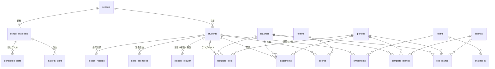

# 05 テーブル定義書

DB は Supabase（PostgreSQL）。定義の原本は `supabase/migrations/` の SQL です。

共通事項
- 主キー `id` は `uuid`（`gen_random_uuid()`）。例外は表ごとに記載
- 全テーブルで RLS を有効化。ポリシー「authenticated all」（ログイン済みなら全操作可）。`ai_usage` だけはポリシーなし（サーバーの service role からのみ操作）
- 「FK」は外部キー。「cascade」は親を消すと子も消える

## 1. ER図

`availability.person_id` は先生または生徒のID（`person_type` で区別、FKなし）。`day_status`・`promotions`・`ai_usage`・`target_schools`・`target_school_regions` は独立。

## 2. マスタ

### teachers（先生）
| 列 | 型 | 必須 | 説明 |
|---|---|---|---|
| id | uuid | ○ | 主キー |
| name | text | ○ | 氏名 |
| subjects | text[] | ○ | 担当科目（9教科のいずれか）。既定 `{}` |
| grades | text[] | ○ | 担当学年（小1〜高3）。既定 `{}` |
| weekdays | int[] | ○ | 出勤曜日（0=日〜6=土）。既定 `{}` |

### students（生徒）
| 列 | 型 | 必須 | 説明 |
|---|---|---|---|
| id | uuid | ○ | 主キー |
| name | text | ○ | 氏名 |
| grade | text | ○ | 学年（小1〜高3、卒業） |
| school_id | uuid |  | FK schools（学校削除時は null） |

### student_regular（通常期の受講）
| 列 | 型 | 必須 | 説明 |
|---|---|---|---|
| id | uuid | ○ | 主キー |
| student_id | uuid | ○ | FK students（cascade） |
| weekday | int | ○ | 0〜6 |
| subject | text | ○ | 科目 |

一意：(student_id, weekday, subject)

### periods（コマ）
| 列 | 型 | 必須 | 説明 |
|---|---|---|---|
| id | uuid | ○ | 主キー |
| name | text | ○ | 例：1限 |
| start_time / end_time | time | ○ | 開始・終了時刻 |
| sort_order | int | ○ | 並び順（既定0） |

### terms（期間）
| 列 | 型 | 必須 | 説明 |
|---|---|---|---|
| id | uuid | ○ | 主キー |
| name | text | ○ | 例：2026年 夏期講習 |
| kind | text | ○ | `regular`（通常期）／`kosyu`（講習） |
| start_date / end_date | date | ○ | 期間（start ≦ end） |

### schools（学校）
| 列 | 型 | 必須 | 説明 |
|---|---|---|---|
| id | uuid | ○ | 主キー |
| name | text | ○ | 学校名 |
| kind | text | ○ | `小`／`中`／`高` |

### islands（島）
| 列 | 型 | 必須 | 説明 |
|---|---|---|---|
| id | uuid | ○ | 主キー |
| name | text | ○ | 例：A島、窓側 |
| sort_order | int | ○ | 並び順 |

## 3. 時間割

### enrollments（講習の申込コマ数）
| 列 | 型 | 必須 | 説明 |
|---|---|---|---|
| id | uuid | ○ | 主キー |
| term_id | uuid | ○ | FK terms（cascade） |
| student_id | uuid | ○ | FK students（cascade） |
| subject | text | ○ | 科目 |
| count | int | ○ | 申込コマ数（1以上） |

一意：(term_id, student_id, subject)

### availability（来塾可否）
| 列 | 型 | 必須 | 説明 |
|---|---|---|---|
| id | uuid | ○ | 主キー |
| term_id | uuid | ○ | FK terms（cascade） |
| person_type | text | ○ | `teacher`／`student` |
| person_id | uuid | ○ | 先生または生徒のID |
| date | date | ○ | 日付 |
| available | boolean | ○ | true=来られる／false=来られない（行がなければ「いつも通り」） |

一意：(term_id, person_type, person_id, date)

### placements（配置）
| 列 | 型 | 必須 | 説明 |
|---|---|---|---|
| id | uuid | ○ | 主キー |
| date | date | ○ | 日付 |
| period_id | uuid | ○ | FK periods（cascade） |
| teacher_id | uuid | ○ | FK teachers（cascade） |
| student_id | uuid | ○ | FK students（cascade） |
| subject | text | ○ | 科目 |

一意：(date, period_id, student_id) … 同じコマへの二重配置を防ぐ

### extra_attendees（緊急の曜日変更）
| 列 | 型 | 必須 | 説明 |
|---|---|---|---|
| id | uuid | ○ | 主キー |
| date | date | ○ | 日付 |
| student_id | uuid | ○ | FK students（cascade） |

一意：(date, student_id)

### template_slots（曜日テンプレートの配置）
| 列 | 型 | 必須 | 説明 |
|---|---|---|---|
| id | uuid | ○ | 主キー |
| weekday | int | ○ | 1〜5（月〜金） |
| period_id / teacher_id / student_id | uuid | ○ | FK（cascade） |
| subject | text | ○ | 科目 |

一意：(weekday, period_id, student_id)

### day_status（テンプレート反映済みの日）
| 列 | 型 | 必須 | 説明 |
|---|---|---|---|
| date | date | ○ | **主キー** |
| from_template | boolean | ○ | 既定 true（未使用） |
| created_at | timestamptz | ○ | 反映日時 |

### cell_islands（その日のマスの島）
| 列 | 型 | 必須 | 説明 |
|---|---|---|---|
| id | uuid | ○ | 主キー |
| date | date | ○ | 日付 |
| period_id / teacher_id / island_id | uuid | ○ | FK（cascade） |

一意：(date, period_id, teacher_id)

### template_islands（テンプレートのマスの島）
cell_islands の `date` の代わりに `weekday`（1〜5）。一意：(weekday, period_id, teacher_id)

## 4. 成績

### exams（定期テスト）
| 列 | 型 | 必須 | 説明 |
|---|---|---|---|
| id | uuid | ○ | 主キー |
| name | text | ○ | 例：2026年度 1学期 中間 |
| year | int | ○ | 年度 |
| semester | int | ○ | 1〜3 |
| kind | text | ○ | `midterm`／`final` |

### scores（点数）
| 列 | 型 | 必須 | 説明 |
|---|---|---|---|
| id | uuid | ○ | 主キー |
| exam_id | uuid | ○ | FK exams（cascade） |
| student_id | uuid | ○ | FK students（cascade） |
| subject | text | ○ | 科目 |
| score | int |  | 0〜100。null は未入力 |

一意：(exam_id, student_id, subject)

### promotions（学年を繰り上げた年度）
| 列 | 型 | 必須 | 説明 |
|---|---|---|---|
| year | int | ○ | **主キー**。年度 |
| done_at | timestamptz | ○ | 実行日時 |

## 5. 教材・疑似テスト

### school_materials（学校の使用教材）
| 列 | 型 | 必須 | 説明 |
|---|---|---|---|
| id | uuid | ○ | 主キー |
| school_id | uuid | ○ | FK schools（cascade） |
| grade | text | ○ | 学年 |
| subject | text | ○ | 科目 |
| name | text | ○ | 教材名 |
| publisher | text | ○ | 出版社（既定 空文字） |
| memo | text | ○ | メモ（既定 空文字） |
| created_at | timestamptz | ○ | 登録日時（表示順） |

### material_units（教材の目次）
| 列 | 型 | 必須 | 説明 |
|---|---|---|---|
| id | uuid | ○ | 主キー |
| material_id | uuid | ○ | FK school_materials（cascade） |
| name | text | ○ | 単元名 |
| sort_order | int | ○ | 並び順 |

### generated_tests（AIで作った疑似テスト）
| 列 | 型 | 必須 | 説明 |
|---|---|---|---|
| id | uuid | ○ | 主キー |
| material_id | uuid | ○ | FK school_materials（cascade） |
| unit_names | text[] | ○ | 範囲の単元名（作成時点のコピー） |
| difficulty | text | ○ | `basic`／`standard`／`advanced` |
| test_type | text | ○ | `general`・`grammar`・`vocabulary` など（既定 `general`） |
| title | text | ○ | タイトル |
| questions | jsonb | ○ | `[{unit, question, choices[], answer, explanation}]` |
| created_at | timestamptz | ○ | 作成日時 |

### ai_usage（AIの利用回数）
| 列 | 型 | 必須 | 説明 |
|---|---|---|---|
| day | date | ○ | 日本時間の日付（主キーの一部） |
| kind | text | ○ | `test`（疑似テスト）／`research`（志望校調査）（主キーの一部） |
| count | int | ○ | その日の利用回数 |

## 6. 志望校

### target_schools（志望校）
| 列 | 型 | 必須 | 説明 |
|---|---|---|---|
| id | uuid | ○ | 主キー |
| mext_code | text | ○ | 文科省の学校コード（一意） |
| kind | text | ○ | `中学`／`高校` |
| pref_code | text | ○ | 都道府県コード（01〜47） |
| establishment | text | ○ | `国立`／`公立`／`私立` |
| name / address / postal | text | ○ | 学校名・所在地・郵便番号 |
| closed | boolean | ○ | 閉校（最新データにない） |
| synced_at | timestamptz | ○ | 最後に公式データと照合した日時 |
| hensachi / courses / exam_schedule / exam_subjects / competition / career_note | text | ○ | AI調査または手入力の項目（既定 空文字） |
| sources | jsonb | ○ | 出典 `[{url, title}]` |
| researched_at | timestamptz |  | 最後にAIで調べた日時 |

### target_school_regions（登録済みの地域）
| 列 | 型 | 必須 | 説明 |
|---|---|---|---|
| pref_code | text | ○ | **主キー**。都道府県コード |
| registered_at | timestamptz | ○ | 登録日時 |

## 6.5 授業記録

### lesson_records（授業記録）
| 列 | 型 | 必須 | 説明 |
|---|---|---|---|
| id | uuid | ○ | 主キー |
| student_id | uuid | ○ | FK students（cascade） |
| date | date | ○ | 授業日 |
| period_id / teacher_id | uuid |  | FK（削除時 null） |
| placement_id | uuid |  | FK placements（削除時 null）。一意（配置1つにつき記録1件） |
| subject | text | ○ | 科目 |
| material_id | uuid |  | FK school_materials（削除時 null） |
| unit_names | text[] | ○ | やった範囲（単元名のコピー） |
| understanding | text | ○ | ◎・○・△・× |
| homework / note | text | ○ | 宿題・申し送り（既定 空文字） |
| teacher_name | text | ○ | 記録時点の担当の名前 |
| created_at | timestamptz | ○ | 作成日時 |

## 7. DB関数

| 関数 | 権限 | 処理 |
|---|---|---|
| `reset_demo()` | security definer／service role のみ | 全データを初期化して架空データを作成 |
| `apply_template(p_date, p_rows jsonb) → boolean` | invoker／authenticated | `day_status` に挿入できたら配置と島をコピーして true。反映済みなら false |
| `reset_day_to_template(p_date, p_rows jsonb)` | invoker／authenticated | その日の配置・島を消してテンプレートから作り直す |
| `promote_grades(p_year) → boolean` | invoker／authenticated | `promotions` に挿入できたら全生徒の学年を1つ上げる（学校の種類が変わる生徒は学校を未設定に）。済みなら false |
| `consume_ai_quota_kind(p_day, p_kind, p_limit) → boolean` | security definer／service role のみ | 上限未満なら1回分加算して true |
| `refund_ai_quota_kind(p_day, p_kind)` | security definer／service role のみ | 1回分戻す（0未満にしない） |
| `consume_ai_quota` / `refund_ai_quota` | 同上 | 疑似テスト用（kind=`test`）の互換関数 |

## 8. マイグレーション履歴

| 番号 | 内容 |
|---|---|
| 0001 | 段階1：マスタ・時間割のテーブルと RLS |
| 0002 | デモデータ関数（初版） |
| 0003 | 段階2：テンプレート・日付状態・テスト・点数 |
| 0004 | デモデータ（テンプレート・点数） |
| 0005 | テンプレート反映の関数 |
| 0006 | 段階3：学校・島・繰り上げ |
| 0007〜0009 | デモデータ（学校・島）、レビュー対応 |
| 0010〜0011 | 学校の教材とデモデータ |
| 0012〜0013 | 目次・疑似テスト・AI回数、デモの目次 |
| 0014 | 疑似テストの種類 |
| 0015 | 志望校・登録地域・AI回数の用途別化 |
| 0016 | 授業記録 |
