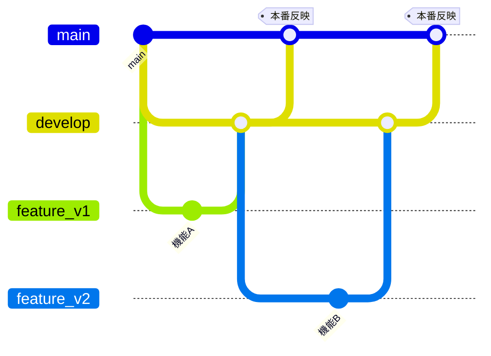

# 08 運用手順書

## 1. 環境

| 環境 | URL | ブランチ | 反映 |
|---|---|---|---|
| 本番（公開デモ） | https://juku-timetable-navy.vercel.app | `main` | push で Vercel が自動デプロイ |
| プレビュー | Vercel が発行 | `develop`・`feature_*` | push で自動 |
| ローカル | http://localhost:3000 | 作業中のブランチ | `npm.cmd run dev` |

DB（Supabase）は全環境で **1つを共有** しています。DB の変更は、マージ前でも公開版に影響します。

## 2. ブランチ運用



ルール
1. 作業は `feature_vN` ブランチでコミットする（develop・main に直接コミットしない）
2. **前回の作業から日付が変わったら**、develop から番号を1つ上げたブランチを作る（`feature_v1` → `feature_v2` → …）。同じ日は同じブランチで続ける
3. マージの順番は **feature → develop → main**。どれも `--no-ff`（マージの記録を残す）
4. 各ブランチで CI が成功してから次へマージする
5. **main へのマージは、本番に反映されるので毎回確認してから** 行う

新しい日のブランチを作る：
```bash
git checkout develop
```
```bash
git pull
```
```bash
git checkout -b feature_v3
```
```bash
git push -u origin feature_v3
```

> 開発用サーバーを動かしたまま `git checkout` でブランチを切り替えると、`.next` が壊れて localhost が 500 エラーになります。切り替える前にサーバーを止めるか、別フォルダ（`git worktree`）でマージしてください。

## 3. CI／CD

| 仕組み | 内容 |
|---|---|
| CI（`.github/workflows/ci.yml`） | `main`・`develop`・`feature_*` への push と、`develop`・`main` 向けのプルリクエストで、型チェック → テスト → 本番用ビルドを実行 |
| CD | Vercel の Git 連携。`main` への push で本番、それ以外のブランチはプレビューへ自動デプロイ |
| ビルド時の値 | CI では `NEXT_PUBLIC_*` にダミー値を入れてビルド。本物のキーは Vercel にのみ登録 |

CI の結果は GitHub の **Actions** タブで確認できます。

（任意）main を守る設定：GitHub の **Settings → Branches → Add branch ruleset** で `main` を対象に「Require a pull request before merging」「Require status checks to pass（check）」をオンにする。

## 4. DB の変更（マイグレーション）

1. `supabase/migrations/` に次の番号の SQL を追加する（例：`0016_xxx.sql`）
   - **適用済みのファイルは書き換えない**。直したいときは新しい番号のファイルを追加する
   - デモデータの関数を変えるときは、最新の `reset_demo` を全文コピーして新しいファイルで `create or replace` する
2. 適用する
   ```bash
   npx.cmd supabase@2.58.5 db push --linked
   ```
3. 適用状況を確認する
   ```bash
   npx.cmd supabase@2.58.5 migration list --linked
   ```

注意
- Supabase は WHERE のない UPDATE を拒否します（`where 条件` を付ける）
- DB は全環境で共有なので、列の削除や名前変更は、古いコード（本番）が動かなくならない順番で行う

## 5. 環境変数

| 変数 | ローカル | Vercel | 変更時 |
|---|---|---|---|
| `NEXT_PUBLIC_SUPABASE_URL` | `.env.local` | 登録 | 再デプロイが必要（ビルド時に埋め込み） |
| `NEXT_PUBLIC_SUPABASE_PUBLISHABLE_KEY` | `.env.local` | 登録 | 同上 |
| `SUPABASE_SERVICE_ROLE_KEY` | `.env.local` | 登録 | 再デプロイ |
| `CRON_SECRET` | `.env.local` | 登録 | 再デプロイ |
| `ANTHROPIC_API_KEY` | `.env.local` | 登録 | 再デプロイ |

Vercel で変更した後は、**Deployments → 最新の行の「…」→ Redeploy**、または空のコミットを push して作り直します。

## 6. デモデータ

| 方法 | 内容 |
|---|---|
| 自動 | 毎日 日本時間 3:00 に Vercel Cron が `GET /api/reset` を実行 |
| 手動（画面） | 左メニュー下の「デモデータを初期状態に戻す」 |
| 手動（SQL） | SQL Editor で `select reset_demo();` |

志望校マスタとAIの利用回数は初期化されません。

## 7. AI の費用管理

| 機能 | 1日の上限（デモ全体） | 1回の目安 | 1日の最大の目安 |
|---|---|---|---|
| 疑似テスト | 20回 | 数円〜10円 | 約200円 |
| 志望校のAI調査 | 10校 | 20〜50円 | 約500円 |

- 上限は日本時間の日付で切り替わります
- 上限を変えるときは `src/domain/ai-test.ts` の `AI_DAILY_LIMIT`、`src/domain/school-research.ts` の `RESEARCH_DAILY_LIMIT`
- 念のため、Anthropic Console の **Limits** で月の利用上限も設定してください
- 利用回数の確認（SQL Editor）：`select * from ai_usage order by day desc;`

## 8. 障害時の確認

| 症状 | 確認すること |
|---|---|
| 本番が 500（`MIDDLEWARE_INVOCATION_FAILED`） | Vercel の環境変数が入っているか → 再デプロイ |
| 本番でAIが使えない | Vercel に `ANTHROPIC_API_KEY` があるか、上限に達していないか、Anthropic の残高 |
| 志望校の登録が失敗する | 文科省のページ構成が変わっていないか（CSVリンクの形式）。Vercel の Logs を確認 |
| デモが毎朝初期化されない | Vercel の **Settings → Cron Jobs** と `CRON_SECRET` |
| CI が失敗する | GitHub Actions のログ。ローカルで `npx.cmd tsc --noEmit` と `npx.cmd vitest run` |
